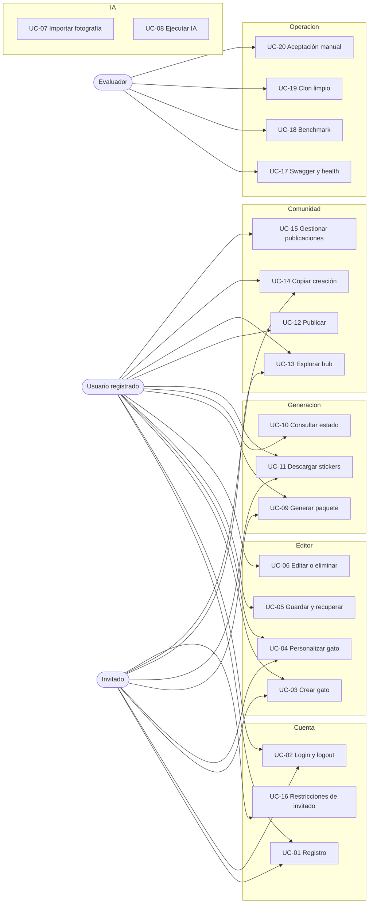
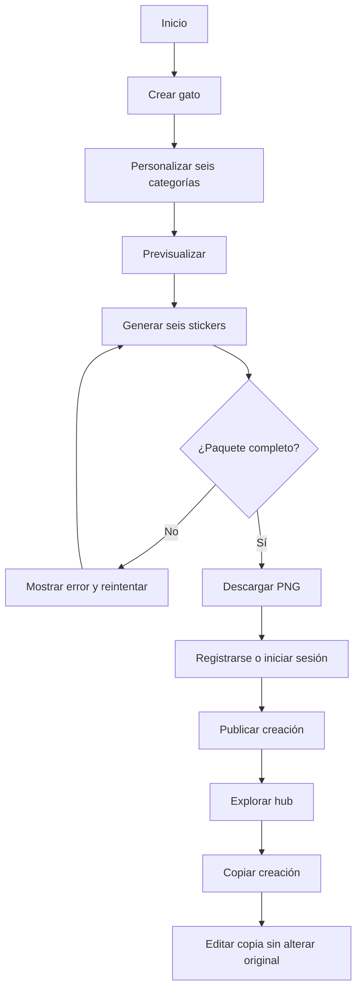
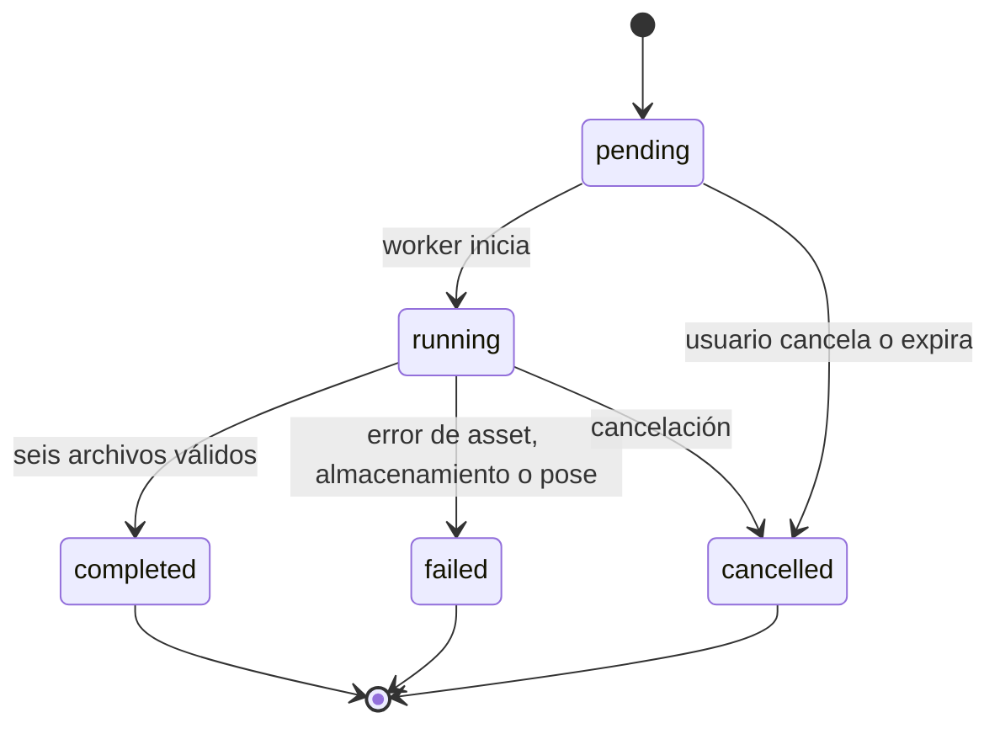

# 14 · Casos de uso, entradas y pruebas — Kitchi Studio

Catálogo de comprobación funcional · Versión 1.0 · 28 de octubre de 2026

> Este documento responde a la exigencia de la sustentación: cada caso de uso debe poder comprobarse con **pruebas unitarias, pruebas de integración y recorrido manual**, indicando **entrada**, **proceso**, **resultado esperado** y **casos de error**. La ejecución real se registra en [`reports/usecase-coverage.md`](reports/usecase-coverage.md); aquí se define qué se debe probar y cómo.

## 1. Convenciones

- **U:** prueba unitaria, sin base de datos ni interfaz.
- **I:** prueba de integración, con API, base de datos y/o motor real.
- **M:** recorrido manual reproducible por el evaluador.
- **Entrada:** datos, archivo o acción del actor.
- **Proceso:** pasos esperados del sistema.
- **Resultado esperado:** respuesta observable y persistencia.
- **Errores:** condiciones inválidas, código HTTP o mensaje visible.
- Los nombres de endpoints son los de [`05_API_CONTRACTS.md`](05_API_CONTRACTS.md); los definitivos se fijan en P03.
- Ningún caso se marca como aprobado sin evidencia. Si una función está simulada, se indica en el caso.

## 2. Actores

| Actor | Puede hacer | No puede hacer |
| --- | --- | --- |
| Invitado | Crear hasta 3 gatos locales, personalizar, generar y descargar stickers, copiar publicaciones | Publicar en el hub, editar datos de otros, conservar datos si borra el almacenamiento local |
| Usuario registrado | Guardar hasta 3 gatos, publicar, explorar, copiar, gestionar sus creaciones | Editar o eliminar creaciones ajenas |
| Evaluador / docente | Ejecutar el recorrido manual, abrir Swagger, revisar evidencias | Modificar datos de otros usuarios |
| Sistema / API | Validar, autorizar, persistir, generar stickers, registrar trabajos | Aprobar operaciones sin autenticación cuando se requiera |

## 3. Diagrama de casos de uso

## 4. Flujo principal

## 5. Estados de un trabajo de generación

## 6. Catálogo detallado

### UC-01 · Registro de usuario

| Campo | Contenido |
| --- | --- |
| Actor | Invitado |
| Precondición | No existe una sesión autenticada |
| Entrada | `username`, `email`, `password`, `password_confirm` |
| Proceso | 1. Validar campos y formato de email. 2. Comprobar unicidad de usuario y email. 3. Validar fortaleza y coincidencia de contraseñas. 4. Crear usuario con contraseña hasheada. 5. Devolver sesión o token según el ADR de autenticación. |
| Resultado esperado | `201 Created`; usuario persistido; contraseña nunca devuelta ni almacenada en texto plano; la sesión queda iniciada. |
| Errores | `400 USERNAME_TAKEN`, `400 EMAIL_TAKEN`, `400 EMAIL_INVALID`, `400 PASSWORD_WEAK`, `400 PASSWORD_MISMATCH`, `400 VALIDATION_ERROR`, `500 INTERNAL_ERROR` sin traza interna. |
| Pruebas | **U:** validadores y hashing. **I:** registro real contra MySQL. **M:** crear cuenta desde la interfaz y comprobar login posterior. |
| Trazabilidad | AC-06, AR-03, UC-02 |

### UC-02 · Inicio y cierre de sesión

| Campo | Contenido |
| --- | --- |
| Actor | Invitado / usuario registrado |
| Precondición | Usuario existente y activo |
| Entrada | `username` o `email`, `password`; para logout, sesión activa |
| Proceso | 1. Buscar usuario. 2. Verificar contraseña con el hash. 3. Rechazar cuentas inactivas. 4. Crear sesión o token. 5. En logout, invalidar la sesión. |
| Resultado esperado | `200 OK` con identidad mínima; logout `204 No Content`; las rutas privadas quedan protegidas. |
| Errores | `401 INVALID_CREDENTIALS`, `403 ACCOUNT_INACTIVE`, `400 VALIDATION_ERROR`, `401 NOT_AUTHENTICATED` al cerrar sin sesión. |
| Pruebas | **U:** verificación de credenciales. **I:** login/logout y acceso a ruta privada. **M:** iniciar sesión, recargar y cerrar sesión. |
| Trazabilidad | AC-06, AR-03, UC-01 |

### UC-03 · Crear gato

| Campo | Contenido |
| --- | --- |
| Actor | Invitado o usuario registrado |
| Precondición | Catálogo cargado |
| Entrada | `name`, `configuration` con las seis categorías y `schema_version` |
| Proceso | 1. Validar nombre y estructura. 2. Validar cada opción contra el catálogo activo. 3. Comprobar compatibilidad de capas. 4. Para invitado, guardar localmente; para registrado, persistir en MySQL. 5. Devolver el gato creado. |
| Resultado esperado | `201 Created`; configuración recuperable; el editor muestra la apariencia correspondiente. |
| Errores | `400 INVALID_CATALOG_OPTION`, `400 INCOMPLETE_CONFIG`, `400 INVALID_NAME`, `400 INCOMPATIBLE_LAYERS`, `401 NOT_AUTHENTICATED` si se usa la API sin sesión, `507 LOCAL_STORAGE_FULL` en invitado. |
| Pruebas | **U:** validación del documento de configuración. **I:** creación y recuperación. **M:** crear un gato desde cero. |
| Trazabilidad | AC-01, AC-02, AR-03, UC-04 |

### UC-04 · Personalizar gato

| Campo | Contenido |
| --- | --- |
| Actor | Invitado o usuario registrado |
| Precondición | Gato existente en el editor |
| Entrada | Acción de selección de categoría y `option_code` |
| Proceso | 1. Validar que la categoría y la opción existen. 2. Comprobar compatibilidad con las capas actuales. 3. Actualizar la configuración. 4. Recalcular la previsualización. 5. Marcar cambios sin guardar. |
| Resultado esperado | La previsualización cambia; las seis categorías son modificables; la configuración sigue siendo válida. |
| Errores | `400 UNKNOWN_CATEGORY`, `400 INVALID_CATALOG_OPTION`, `400 INCOMPATIBLE_LAYERS`, `403 PREMIUM_REQUIRED` si la opción es premium simulada, `409 ASSET_MISSING` si falta un recurso. |
| Pruebas | **U:** reglas de compatibilidad y catálogo. **I:** actualización de configuración. **M:** cambiar las seis categorías y verificar el resultado visual. |
| Trazabilidad | AC-01, AC-02, UC-03 |

### UC-05 · Guardar, recuperar y limitar gatos

| Campo | Contenido |
| --- | --- |
| Actor | Usuario registrado (invitado en almacenamiento local) |
| Precondición | Configuración válida |
| Entrada | `name`, `configuration`; para recuperar, `cat_id` |
| Proceso | 1. Validar sesión y propiedad. 2. Abrir transacción. 3. Contar gatos del usuario. 4. Si es creación y ya hay 3, rechazar. 5. Guardar y devolver. |
| Resultado esperado | `201 Created` o `200 OK`; el gato se recupera con la misma configuración; el límite de tres se aplica en backend. |
| Errores | `409 CAT_LIMIT_REACHED`, `403 NOT_OWNER`, `404 CAT_NOT_FOUND`, `400 INVALID_CONFIG`, `409 CONCURRENT_LIMIT` si dos solicitudes compiten por el tercer cupo. |
| Pruebas | **U:** regla de límite. **I:** dos creaciones concurrentes y recuperación. **M:** guardar, reiniciar y recuperar; intentar el cuarto gato. |
| Trazabilidad | AC-05, AR-03, UC-06 |

### UC-06 · Editar o eliminar un gato propio

| Campo | Contenido |
| --- | --- |
| Actor | Usuario registrado |
| Precondición | Gato propio existente |
| Entrada | `PATCH` con cambios o `DELETE` con `cat_id` |
| Proceso | 1. Verificar sesión y propiedad. 2. Validar la nueva configuración. 3. Si está publicado y se intenta borrar, rechazar o exigir despublicar. 4. Aplicar el cambio o borrado lógico/físico definido. 5. Devolver el resultado. |
| Resultado esperado | `200 OK` con la configuración actualizada o `204 No Content`; el original de otro usuario nunca se modifica. |
| Errores | `403 NOT_OWNER`, `404 CAT_NOT_FOUND`, `409 CAT_PUBLISHED`, `400 INVALID_CONFIG`, `401 NOT_AUTHENTICATED`. |
| Pruebas | **U:** permisos de propiedad. **I:** editar/eliminar con dos cuentas. **M:** abrir Mis gatos, editar y eliminar. |
| Trazabilidad | AC-07, AR-03, UC-15 |

### UC-07 · Importar fotografía para IA

| Campo | Contenido |
| --- | --- |
| Actor | Usuario registrado o invitado, según decisión de IA |
| Precondición | Formulario de importación disponible |
| Entrada | Archivo `png`, `jpg` o `jpeg`; consentimiento de procesamiento |
| Proceso | 1. Validar extensión, MIME y tamaño máximo. 2. Verificar que la imagen se puede abrir. 3. Comprobar consentimiento. 4. Guardar en directorio temporal no público. 5. Crear trabajo de IA. |
| Resultado esperado | `202 Accepted` con `ai_job_id`; vista previa de la imagen; archivo temporal con permisos restringidos. |
| Errores | `415 UNSUPPORTED_MEDIA_TYPE`, `413 FILE_TOO_LARGE`, `400 INVALID_IMAGE`, `400 EMPTY_FILE`, `400 CONSENT_REQUIRED`, `507 STORAGE_FULL`. |
| Pruebas | **U:** validadores de archivo. **I:** subida real y creación de job. **M:** subir una foto válida y una inválida; comprobar mensajes. |
| Trazabilidad | AC-08, AR-03, UC-08 |

### UC-08 · Ejecutar IA y revisar el resultado

| Campo | Contenido |
| --- | --- |
| Actor | Usuario que importó la fotografía |
| Precondición | Trabajo de IA creado y proveedor configurado |
| Entrada | `ai_job_id`; decisión de aceptar, reintentar o abandonar |
| Proceso | 1. Ejecutar inferencia real o adaptador documentado. 2. Validar la respuesta. 3. Guardar resultado temporal. 4. Mostrar previsualización. 5. Si se acepta, crear configuración editable o punto de partida; si se rechaza, permitir reintento. |
| Resultado esperado | `200 OK` con estado `completed` y URL temporal; el usuario puede continuar al editor; el trabajo queda registrado con tiempos y proveedor. |
| Errores | `502 AI_INVALID_RESPONSE`, `504 AI_TIMEOUT`, `429 AI_QUOTA_EXCEEDED`, `503 AI_UNAVAILABLE`, `422 AI_CONTENT_REJECTED`, `409 JOB_ALREADY_COMPLETED`, `404 JOB_NOT_FOUND`; si falla, se muestra contingencia y el editor manual sigue disponible. |
| Pruebas | **U:** validación de respuesta y timeout. **I:** job completo con proveedor de prueba; fallo simulado controlado. **M:** ejecutar IA real, mostrar error y continuar manualmente. |
| Trazabilidad | AC-08, AR-03, UC-09 |

### UC-09 · Generar un paquete de seis stickers

| Campo | Contenido |
| --- | --- |
| Actor | Invitado o usuario registrado |
| Precondición | Gato con configuración válida |
| Entrada | `cat_id` o configuración, `pack_id` opcional |
| Proceso | 1. Validar configuración y recursos. 2. Crear trabajo `pending`. 3. Encolar las seis poses. 4. Componer con Pillow en orden de capas. 5. Validar dimensiones y canal alfa. 6. Marcar `completed` solo si existen seis PNG válidos. |
| Resultado esperado | `202 Accepted` con `job_id`; respuesta inmediata sin bloquear; al completar, seis archivos PNG RGBA 512×512 y estado `completed`. |
| Errores | `400 INVALID_CONFIG`, `401 NOT_AUTHENTICATED`, `403 NOT_OWNER`, `409 JOB_ALREADY_RUNNING`, `409 ASSET_MISSING`, `500 PACK_INCOMPLETE`, `507 STORAGE_FULL`; si una pose falla, el paquete queda `failed` y no se declara completo. |
| Pruebas | **U:** composición y validación de PNG. **I:** job completo y job con asset faltante. **M:** generar, abrir los seis archivos y verificar transparencia. |
| Trazabilidad | AC-03, AC-04, UC-10, UC-11 |

### UC-10 · Consultar el estado de generación

| Campo | Contenido |
| --- | --- |
| Actor | Dueño del trabajo |
| Precondición | `job_id` existente |
| Entrada | `GET /api/sticker-packs/{id}/` |
| Proceso | 1. Verificar sesión y propiedad. 2. Leer estado actual. 3. Devolver progreso y, si terminó, las URLs de los stickers. |
| Resultado esperado | `200 OK` con `pending`, `running`, `completed` o `failed`; la interfaz muestra progreso sin bloquearse. |
| Errores | `404 JOB_NOT_FOUND`, `403 NOT_OWNER`, `401 NOT_AUTHENTICATED`, `409 INVALID_STATE` si el estado almacenado es inconsistente. |
| Pruebas | **U:** máquina de estados. **I:** polling hasta completar y hasta fallar. **M:** observar la barra de progreso y el estado final. |
| Trazabilidad | AC-03, AC-09, UC-09 |

### UC-11 · Descargar stickers

| Campo | Contenido |
| --- | --- |
| Actor | Dueño del paquete |
| Precondición | Trabajo `completed` y archivos existentes |
| Entrada | `pack_id`; `pose` opcional para un archivo individual |
| Proceso | 1. Verificar propiedad. 2. Comprobar estado `completed`. 3. Resolver la ruta segura dentro de `storage/`. 4. Servir el archivo o un ZIP. 5. Registrar la descarga. |
| Resultado esperado | `200 OK`; PNG con canal alfa; ZIP con seis archivos; `Content-Disposition` correcto. |
| Errores | `409 PACK_NOT_READY`, `404 FILE_NOT_FOUND`, `403 NOT_OWNER`, `400 INVALID_POSE`, `403 INVALID_PATH` ante intento de path traversal, `401 NOT_AUTHENTICATED`. |
| Pruebas | **U:** resolución segura de rutas. **I:** descarga de paquete y de un sticker. **M:** descargar, abrir y comprobar transparencia. |
| Trazabilidad | AC-03, AC-04, AC-14 |

### UC-12 · Publicar una creación

| Campo | Contenido |
| --- | --- |
| Actor | Usuario registrado |
| Precondición | Gato propio y guardado |
| Entrada | `title`, `description`, `visibility`, `cat_id` |
| Proceso | 1. Verificar sesión y propiedad del gato. 2. Validar título, descripción y visibilidad. 3. Comprobar que no esté ya publicado. 4. Crear publicación independiente del gato. 5. Devolver la publicación. |
| Resultado esperado | `201 Created`; la publicación aparece en el hub; despublicar no borra el gato. |
| Errores | `403 GUEST_CANNOT_PUBLISH`, `403 NOT_OWNER`, `404 CAT_NOT_FOUND`, `409 ALREADY_PUBLISHED`, `400 INVALID_TITLE`, `400 INVALID_VISIBILITY`. |
| Pruebas | **U:** validación de publicación y permisos. **I:** publicar y consultar desde otra cuenta. **M:** publicar y buscar en el hub. |
| Trazabilidad | AC-07, AR-03, UC-13 |

### UC-13 · Explorar el hub

| Campo | Contenido |
| --- | --- |
| Actor | Invitado o usuario registrado |
| Precondición | Existen publicaciones públicas o no |
| Entrada | `page`, `page_size`, filtros opcionales |
| Proceso | 1. Consultar solo publicaciones públicas. 2. Paginar. 3. Devolver resumen y miniatura. 4. Excluir datos privados. |
| Resultado esperado | `200 OK` con lista paginada; estado vacío comprensible si no hay publicaciones; nunca se muestran borradores. |
| Errores | `400 INVALID_PAGE`, `400 INVALID_PAGE_SIZE`, `500 INTERNAL_ERROR` sin datos sensibles. |
| Pruebas | **U:** filtro de visibilidad. **I:** hub con dos cuentas y estado vacío. **M:** explorar, paginar y abrir una publicación. |
| Trazabilidad | AC-07, AR-03, UC-14 |

### UC-14 · Copiar una creación pública

| Campo | Contenido |
| --- | --- |
| Actor | Usuario registrado |
| Precondición | Publicación pública existente |
| Entrada | `publication_id` |
| Proceso | 1. Verificar sesión. 2. Verificar que la publicación sea pública. 3. Copiar la configuración a un gato nuevo del usuario actual. 4. Aplicar el límite de tres gatos. 5. Devolver el nuevo gato. |
| Resultado esperado | `201 Created`; copia independiente; editar la copia no altera el original; el autor original no cambia. |
| Errores | `401 NOT_AUTHENTICATED`, `404 PUBLICATION_NOT_FOUND`, `403 PUBLICATION_NOT_PUBLIC`, `409 CAT_LIMIT_REACHED`, `409 COPY_CONFLICT` si el original se elimina durante la copia. |
| Pruebas | **U:** copia profunda de configuración. **I:** dos cuentas, copiar y editar. **M:** verificar que el original no cambia. |
| Trazabilidad | AC-07, AR-03, UC-15 |

### UC-15 · Gestionar publicaciones propias

| Campo | Contenido |
| --- | --- |
| Actor | Usuario registrado |
| Precondición | Publicación propia existente |
| Entrada | `PATCH` de título/descripción/visibilidad o `DELETE` |
| Proceso | 1. Verificar sesión y propiedad. 2. Validar cambios. 3. Aplicar. 4. Reflejar el cambio en el hub. |
| Resultado esperado | `200 OK` o `204 No Content`; el gato sigue existiendo; la publicación deja de mostrarse si se retira. |
| Errores | `403 NOT_OWNER`, `404 PUBLICATION_NOT_FOUND`, `400 INVALID_VISIBILITY`, `401 NOT_AUTHENTICATED`. |
| Pruebas | **U:** permisos. **I:** editar/retirar y comprobar el hub. **M:** retirar una publicación y verificar que el gato permanece. |
| Trazabilidad | AC-07, UC-12, UC-13 |

### UC-16 · Restricciones del modo invitado

| Campo | Contenido |
| --- | --- |
| Actor | Invitado |
| Precondición | Sesión sin autenticación |
| Entrada | Intento de publicar, guardar en servidor o acceder a datos de otro usuario |
| Proceso | 1. Detectar ausencia de sesión. 2. Permitir solo operaciones locales y públicas. 3. Rechazar publicación y escritura remota. 4. Mostrar aviso de pérdida de datos locales. |
| Resultado esperado | El invitado puede crear, personalizar, generar, descargar y copiar; la interfaz explica que sus datos pueden perderse al borrar el almacenamiento. |
| Errores | `403 GUEST_CANNOT_PUBLISH`, `401 NOT_AUTHENTICATED`, `403 NOT_OWNER`; no se presenta el almacenamiento local como protección contra manipulación. |
| Pruebas | **U:** guardas de permisos. **I:** invitado intenta publicar. **M:** recorrer el flujo de invitado y leer el aviso. |
| Trazabilidad | AC-05, AC-07, AR-03 |

### UC-17 · Consultar Swagger y health

| Campo | Contenido |
| --- | --- |
| Actor | Evaluador / desarrollador |
| Precondición | Backend en ejecución |
| Entrada | `GET /api/health/`, `GET /api/schema/`, `GET /api/docs/` |
| Proceso | 1. Comprobar disponibilidad. 2. Generar/esquema OpenAPI. 3. Cargar Swagger UI. 4. Verificar que los endpoints principales aparecen. |
| Resultado esperado | `200 OK`; Swagger navegable; esquema con autenticación y errores; permite probar al menos un endpoint público y uno autenticado. |
| Errores | `503 SERVICE_UNAVAILABLE` si la base de datos no responde; `500 SCHEMA_ERROR` si el esquema no genera; la ausencia de Swagger impide cumplir AC-18. |
| Pruebas | **U:** generación de esquema. **I:** health y carga de Swagger. **M:** abrir `/api/docs/` y probar un endpoint. |
| Trazabilidad | AC-18, AR-06 |

### UC-18 · Ejecutar benchmark y evidencias de concurrencia

| Campo | Contenido |
| --- | --- |
| Actor | Integrante C / evaluador |
| Precondición | Motor de composición funcionando |
| Entrada | Conjunto fijo de imágenes, configuración, repeticiones y número de trabajadores |
| Proceso | 1. Ejecutar modalidad secuencial. 2. Ejecutar modalidad con procesos. 3. Registrar tiempos, procesos y errores. 4. Calcular aceleración. 5. Guardar resultados. |
| Resultado esperado | Informe reproducible con equipo, versión de Python, tamaños, repeticiones y aceleración real; procesos identificados; conclusión honesta aunque el paralelismo no sea más rápido. |
| Errores | `BENCHMARK_NO_ASSETS`, `BENCHMARK_SPAWN_ERROR` en Windows sin `if __name__ == "__main__":`, `BENCHMARK_PARTIAL_FAILURE`; si no se puede ejecutar, se documenta y no se inventan cifras. |
| Pruebas | **U:** cálculo de aceleración y validación de resultados. **I:** ejecución con recursos reales. **M:** repetir el comando durante la demo. |
| Trazabilidad | AC-09, AC-10, AC-11 |

### UC-19 · Instalar desde un clon limpio

| Campo | Contenido |
| --- | --- |
| Actor | Evaluador / integrante distinto del configurador |
| Precondición | Repositorio público y README actualizado |
| Entrada | URL del repositorio, Python, MySQL y `.env` local |
| Proceso | 1. Clonar. 2. Crear entorno virtual. 3. Instalar dependencias. 4. Configurar `.env`. 5. Migrar. 6. Cargar datos de demostración. 7. Iniciar backend y frontend. 8. Abrir Swagger y ejecutar pruebas. |
| Resultado esperado | La aplicación arranca sin pasos no documentados; los datos de demostración se cargan; las pruebas pasan; no se requiere editar el código. |
| Errores | `MYSQL_UNAVAILABLE`, `ENV_MISSING`, `MIGRATION_FAILED`, `DEPENDENCY_MISSING`, `PORT_IN_USE`; cada uno debe tener solución documentada en el README. |
| Pruebas | **I:** instalación real en directorio nuevo. **M:** seguir el README al pie de la letra. **U:** no aplica. |
| Trazabilidad | AC-13, AC-16, AR-10, AR-12 |

### UC-20 · Recorrido manual de aceptación

| Campo | Contenido |
| --- | --- |
| Actor | Evaluador / docente |
| Precondición | Datos de demostración cargados y servicios levantados |
| Entrada | Cuenta de prueba, personaje de ejemplo y fotografía de prueba |
| Proceso | Ejecutar los 13 pasos de [`09_TEST_PLAN.md`](09_TEST_PLAN.md#escenario-de-aceptación-principal): clonar, Swagger, invitado, seis categorías, paquete, transparencia, cuenta, publicar, copiar, IA, benchmark, persistencia y explicación de un módulo. |
| Resultado esperado | Todos los pasos se completan sin editar la base de datos a mano; los errores provocados muestran mensajes comprensibles; el evaluador puede repetir el recorrido. |
| Errores | Cualquier paso fallido se registra con UC asociado, captura y corrección; un fallo bloqueante impide declarar la aceptación. |
| Pruebas | **M:** recorrido completo cronometrado. **I:** los pasos de API se verifican con Swagger. **U:** los pasos de reglas se cubren en unitarias. |
| Trazabilidad | AC-01…AC-22, AR-01…AR-21 |

## 7. Matriz de cobertura

> Estado inicial: **pendiente**. Se actualiza en [`reports/usecase-coverage.md`](reports/usecase-coverage.md) después de ejecutar cada prueba. `U`, `I` y `M` indican el tipo de comprobación previsto.

| UC | U | I | M | Criterios |
| --- | :---: | :---: | :---: | --- |
| UC-01 Registro | ☐ | ☐ | ☐ | AC-06 |
| UC-02 Login/logout | ☐ | ☐ | ☐ | AC-06 |
| UC-03 Crear gato | ☐ | ☐ | ☐ | AC-01, AC-02 |
| UC-04 Personalizar | ☐ | ☐ | ☐ | AC-01, AC-02 |
| UC-05 Guardar y límite | ☐ | ☐ | ☐ | AC-05 |
| UC-06 Editar/eliminar | ☐ | ☐ | ☐ | AC-07 |
| UC-07 Importar foto | ☐ | ☐ | ☐ | AC-08 |
| UC-08 IA | ☐ | ☐ | ☐ | AC-08 |
| UC-09 Generar paquete | ☐ | ☐ | ☐ | AC-03, AC-04 |
| UC-10 Consultar estado | ☐ | ☐ | ☐ | AC-03, AC-09 |
| UC-11 Descargar | ☐ | ☐ | ☐ | AC-03, AC-04 |
| UC-12 Publicar | ☐ | ☐ | ☐ | AC-07 |
| UC-13 Explorar hub | ☐ | ☐ | ☐ | AC-07 |
| UC-14 Copiar | ☐ | ☐ | ☐ | AC-07 |
| UC-15 Gestionar publicaciones | ☐ | ☐ | ☐ | AC-07 |
| UC-16 Invitado | ☐ | ☐ | ☐ | AC-05, AC-07 |
| UC-17 Swagger/health | ☐ | ☐ | ☐ | AC-18 |
| UC-18 Benchmark | ☐ | ☐ | ☐ | AC-09…AC-11 |
| UC-19 Clon limpio | — | ☐ | ☐ | AC-13, AC-16 |
| UC-20 Aceptación | — | ☐ | ☐ | AC-01…AC-22 |

## 8. Regla de mantenimiento

- Cada caso de uso nuevo o modificado debe actualizar este documento y la matriz de cobertura.
- Cada error nuevo debe tener una respuesta esperada y una prueba asociada.
- Los diagramas deben reflejar el comportamiento real; si una función está simulada, se indica.
- La guía viva [`12_GUIA_PLATAFORMA.md`](12_GUIA_PLATAFORMA.md) debe enlazar los casos que se explican en la sustentación.
